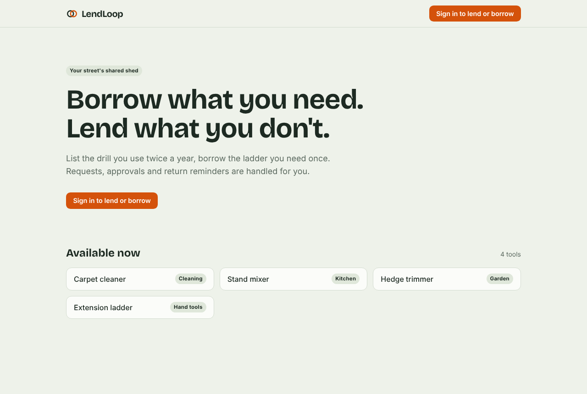
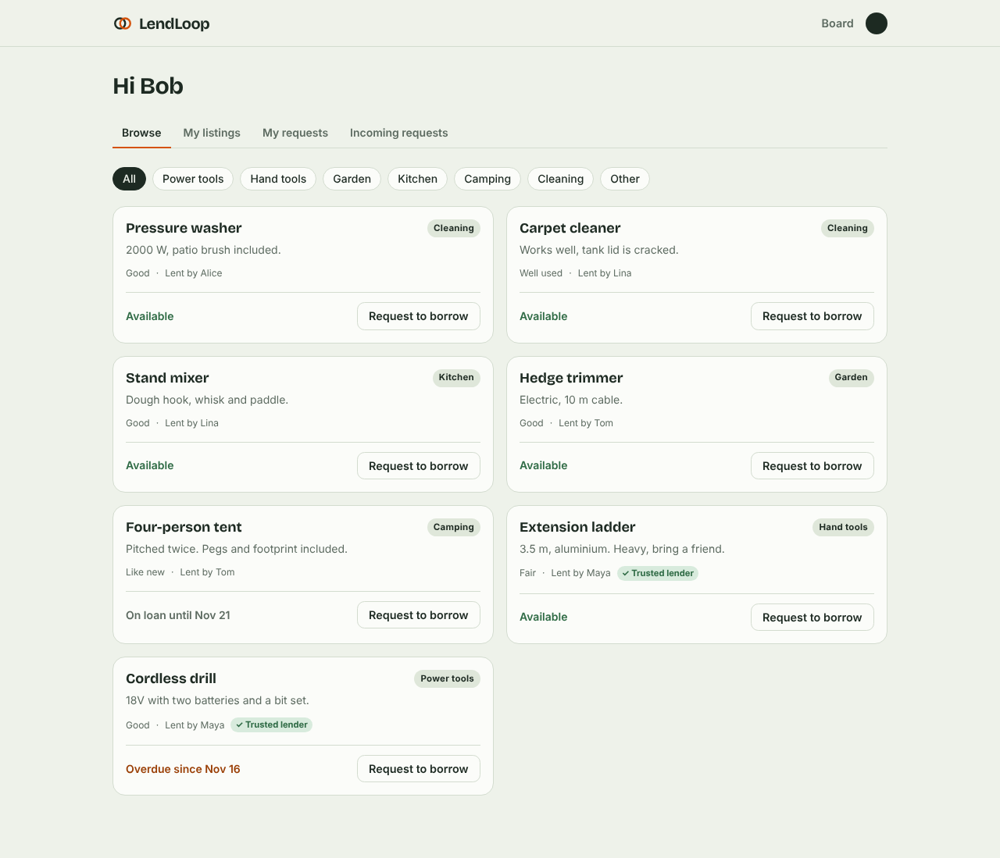
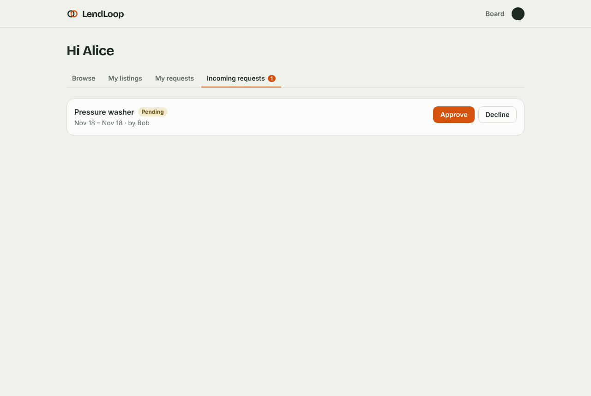
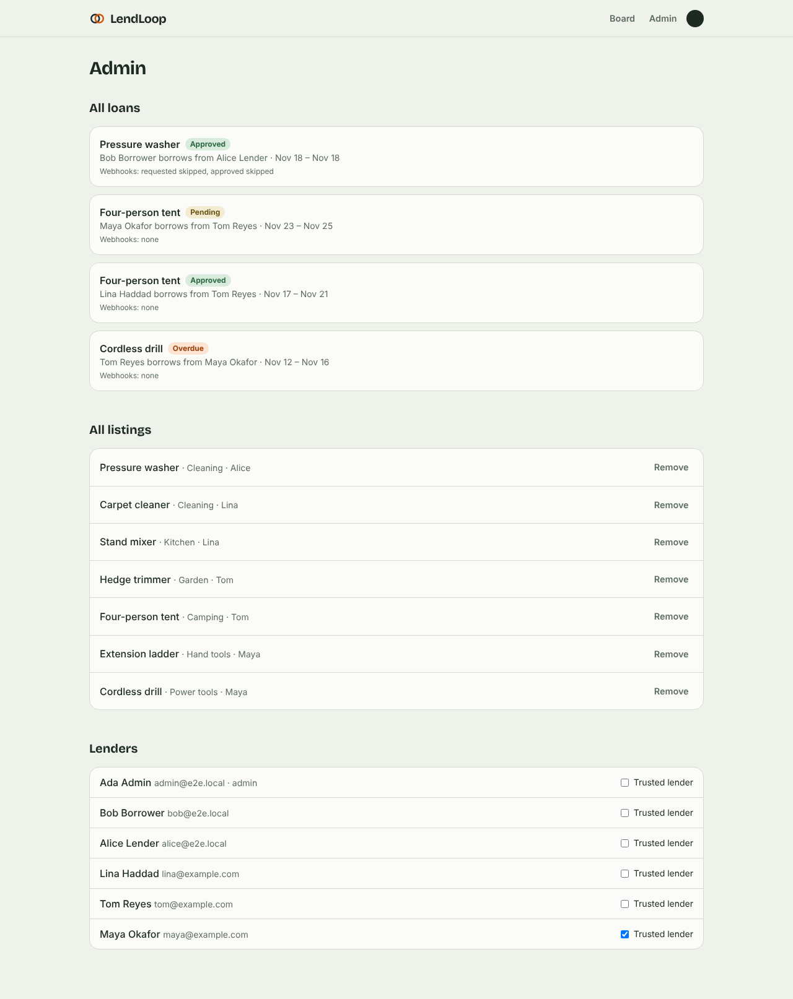
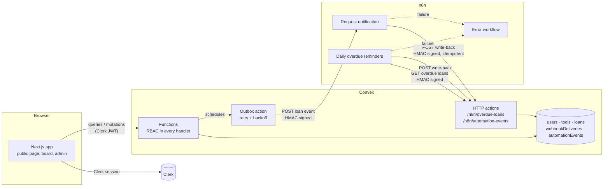

# LendLoop

**Borrow what you need. Lend what you don't.**

A neighbourhood tool-lending board. Neighbours list tools, request to borrow them for a date range, and approve or decline requests on their own tools. Notifications and overdue reminders are handled by n8n workflows that talk to Convex over signed, idempotent webhooks.

Stack: Next.js 16 (App Router) · Clerk · Convex · n8n · TypeScript.

| Public page | Board (signed in) |
|---|---|
|  |  |
| **Incoming requests** | **Admin** |
|  |  |

---

## Contents

1. [Architecture](#architecture)
2. [Roles and access control](#roles-and-access-control)
3. [Automations (n8n)](#automations-n8n)
4. [Local setup](#local-setup)
5. [Environment variables](#environment-variables)
6. [Tests](#tests)
7. [Security and data-minimisation decisions](#security-and-data-minimisation-decisions)
8. [What I would change for production](#what-i-would-change-for-production)

---

## Architecture



**Data model** (`convex/schema.ts`)

| Table | Purpose |
|---|---|
| `users` | One row per signed-in person: name, email, `role` (`admin` / `user`), `trustedLender`. |
| `tools` | A listing: owner, name, category, condition, description. |
| `loans` | A borrow request and, once approved, the loan. Status: `pending → approved → returned`, or `declined` / `cancelled`. Dates are UTC calendar days. |
| `webhookDeliveries` | Outbox for Convex → n8n events, with attempts, status and last error. |
| `automationEvents` | What n8n did for a loan (notification or reminder, sent or failed), keyed by an idempotency key. |

Availability is computed, not stored: a tool is "on loan" when it has an approved loan that has started and isn't returned (an overdue loan still counts). That avoids a status field drifting out of sync with the loans.

**Pages**

- `/` — public. Tagline, the available tools (name and category only), and "Sign in to lend or borrow" wired to Clerk.
- `/app` — signed in. Tabs for **Browse** (every tool with availability, filter by category, request to borrow), **My listings** (create, edit, delete), **My requests**, and **Incoming requests** (approve, decline, mark returned). Each loan shows its automation activity, e.g. "Reminder sent 2 days ago".
- `/admin` — admins. Every loan with its webhook delivery state, every listing (remove), and every user (mark Trusted Lender).

## Roles and access control

Access is enforced inside the Convex functions, not in the UI. Every private query and every mutation starts with `requireUser(ctx)` or `requireAdmin(ctx)` (`convex/lib/auth.ts`), and ownership is checked against the database row, never against anything the client sends. The page-level gate in `proxy.ts` and the hidden admin link are conveniences only.

| Action | user | admin |
|---|---|---|
| See available tools (name + category) | ✓ signed out too | ✓ |
| Browse all tools with availability | ✓ | ✓ |
| Create a listing | ✓ | ✓ |
| Edit / delete a listing | own only | delete any (edit stays owner-only) |
| Request to borrow | any tool except own | same |
| Approve / decline a request | own tools only | own tools only |
| Mark a loan returned | as the lender | any |
| Cancel a request | own pending requests | own |
| View all loans, mark Trusted Lender | ✗ | ✓ |

How someone becomes an admin: `ADMIN_EMAILS` on the Convex deployment. When a user row is first created from the verified Clerk identity, the role is set from that list. A client never sends a role, and `users.store` takes no arguments.

Server-side rules beyond roles: no borrowing your own tool; start date not in the past; end ≥ start; 30-day maximum; no overlap with an approved loan; approving a request automatically declines the pending requests it clashes with; an owner can't delete a tool that's out on loan (an admin removal cancels its open loans and notifies the people involved).

## Automations (n8n)

Three workflows in `n8n/workflows/` (generated from `scripts/build-n8n-workflows.mjs`, so the Code-node JavaScript is reviewable in one place):

1. **Loan request notifications.** Convex → n8n webhook on every request and status change (requested, approved, declined/cancelled, returned). n8n verifies the signature, answers 200 or 401, skips duplicates, composes one message, sends it, and writes the result back to Convex.
2. **Daily overdue reminders.** At 09:00 UTC n8n calls `GET /n8n/overdue-loans` (signed), sends each borrower a reminder, and writes each result back.
3. **Automation errors.** The error workflow both of the above point to. It logs the failed workflow, node, execution id and message.

### Signing, both directions

HMAC-SHA256 with a shared secret (`N8N_WEBHOOK_SECRET` in Convex, `LENDLOOP_WEBHOOK_SECRET` in n8n) over:

```
<unix timestamp>.<METHOD>.<path>.<raw body>
```

sent as `X-LendLoop-Timestamp` and `X-LendLoop-Signature`. Including the method and path stops a valid signature for one endpoint being replayed against another; a ±5-minute timestamp window limits replay in time. Comparison is constant-time on both sides. n8n verifies against the raw request bytes (the webhook's *Raw Body* option), not a re-serialised object. Failed checks return a bare 401; the reason is only logged.

### Reliability

| Concern | How it's handled |
|---|---|
| Convex → n8n call fails | The event is first written to `webhookDeliveries` in the same transaction as the state change, then delivered by a scheduled action. Non-2xx and network errors retry with exponential backoff (30 s, 1, 2, 4 min); after 5 attempts the delivery is marked `failed` and shown on the admin page with the last error. |
| n8n receives the same delivery twice (our 200 was lost, Convex retried) | Each delivery carries `X-LendLoop-Delivery`. The workflow remembers recent ids in workflow static data and skips repeats. |
| Sending the message fails | The send step retries (3 tries), then its error output writes `failed` back to Convex instead of stopping silently. |
| n8n → Convex call fails | HTTP Request nodes retry 5 times, 5 s apart. Anything that still fails ends the execution as failed and triggers the error workflow. |
| Write-back retried | `POST /n8n/automation-events` is idempotent on `idempotencyKey` (`notification:<deliveryId>`, `reminder:<loanId>:<date>`). A repeat is a no-op; a later `sent` upgrades an earlier `failed`; a `failed` never overwrites a `sent`. |
| Reminder workflow re-run on the same day | `GET /n8n/overdue-loans` leaves out loans that already have a successful reminder for today. |

The send step is a logged mock, which the brief allows: each message (recipient, subject, body) is visible in the n8n execution data. For real delivery, replace the *Send notification* node with an Email (SMTP) or Slack node that uses an n8n credential; the retries, error output and write-back around it stay as they are. The workflows deliberately reference no credential, so they import and activate with no manual setup.

## Local setup

Prerequisites: Node 20+, a free [Clerk](https://clerk.com) application, a free [Convex](https://convex.dev) account, Docker (for n8n).

```bash
git clone <this repo> && cd lendloop
npm install
```

**1. Clerk.** Create an application. Under *JWT templates*, create a **Convex** template (it must be named `convex`) and copy its *Issuer* URL. Copy the publishable and secret keys into `.env.local`:

```bash
NEXT_PUBLIC_CLERK_PUBLISHABLE_KEY=pk_test_...
CLERK_SECRET_KEY=sk_test_...
```

**2. Convex.**

```bash
npx convex dev            # creates a dev deployment, writes NEXT_PUBLIC_CONVEX_URL, keeps running
npx convex env set CLERK_JWT_ISSUER_DOMAIN https://<your-instance>.clerk.accounts.dev
npx convex env set ADMIN_EMAILS you@example.com
npx convex env set N8N_WEBHOOK_SECRET "$(openssl rand -hex 32)"   # keep this value for n8n
npm run seed              # optional: demo people, tools and loans (one overdue)
```

**3. App.** In a second terminal: `npm run dev`, then open http://localhost:3000. Sign in with the email you put in `ADMIN_EMAILS` to see `/admin`.

**4. n8n.**

```bash
cp n8n/.env.example n8n/.env      # fill in LENDLOOP_WEBHOOK_SECRET (same value as above),
                                  # CONVEX_SITE_URL (https://<deployment>.convex.site) and N8N_ENCRYPTION_KEY
docker compose up -d n8n
docker compose run --rm n8n-import
```

Open http://localhost:5678, then publish (activate) *LendLoop · Loan request notifications* and *LendLoop · Daily overdue reminders*. The error workflow needs no activation. From the CLI: `docker compose exec n8n n8n publish:workflow --id=LendLoopNotify01` and the same for `LendLoopRemind01`.

Convex has to reach n8n's webhook. A Convex cloud deployment can't call `localhost`, so expose port 5678 with a tunnel (for example `cloudflared tunnel --url http://localhost:5678`) or use n8n Cloud, then:

```bash
npx convex env set N8N_REQUEST_WEBHOOK_URL https://<tunnel-host>/webhook/lendloop-loan-events
```

Until `N8N_REQUEST_WEBHOOK_URL` is set, events are stored and marked `skipped`, so the app works without n8n.

## Environment variables

| Where | Name | Purpose |
|---|---|---|
| `.env.local` | `NEXT_PUBLIC_CONVEX_URL` | Convex deployment URL (written by `npx convex dev`). |
| `.env.local` | `NEXT_PUBLIC_CLERK_PUBLISHABLE_KEY` | Clerk publishable key. |
| `.env.local` | `CLERK_SECRET_KEY` | Clerk secret key (server only). |
| Convex | `CLERK_JWT_ISSUER_DOMAIN` | Issuer of the Clerk `convex` JWT template. |
| Convex | `ADMIN_EMAILS` | Comma-separated admin emails. |
| Convex | `N8N_REQUEST_WEBHOOK_URL` | n8n webhook for loan events. |
| Convex | `N8N_WEBHOOK_SECRET` | Shared HMAC secret. |
| `n8n/.env` | `LENDLOOP_WEBHOOK_SECRET` | Same shared secret. |
| `n8n/.env` | `CONVEX_SITE_URL` | Convex HTTP Actions URL (`.convex.site`). |
| `n8n/.env` | `LENDLOOP_REQUEST_WEBHOOK_PATH` | Path Convex signs; default `/webhook/lendloop-loan-events`. |
| `n8n/.env` | `N8N_ENCRYPTION_KEY` | Encrypts n8n's stored credentials. |

Templates: `.env.example` and `n8n/.env.example`. Real env files are git-ignored. No secret appears in code or in the exported workflow JSON: the workflows read `$env` at run time.

## Tests

```bash
npm test          # Convex functions with convex-test (18 tests)
npm run typecheck
npm run lint
```

The tests cover the rules that matter most: roles come from the server; signed-out callers are rejected; users can't edit or delete other people's listings; only owners decide on requests; only lenders (or admins) mark returns; admin-only functions reject users; the public list exposes name and category only; date and overlap rules; the outbox body is minimal, signed and verifiable; failed deliveries retry five times and end visible as `failed`; write-backs are idempotent (and upgrade failed → sent, never the reverse); reminders already sent today drop out of the next fetch; and the signature check rejects tampered bodies, wrong paths, wrong secrets and stale timestamps.

### End-to-end check

Run locally against a real Convex backend and n8n 2.48.4 (the version pinned in `docker-compose.yml`):

- A borrow request created a delivery in Convex, n8n verified the signature and answered 200, sent the (mock) notification and wrote `sent` back; the delivery and the write-back both show in Convex.
- The reminder workflow fetched the overdue loan, sent one reminder and wrote it back; running it again the same day fetched nothing.
- Calling the n8n webhook directly: a valid call returned 200; the same delivery id again returned 200 but sent nothing and wrote nothing new; a tampered body, a 15-minute-old timestamp and an unsigned call each returned 401.
- In the browser: list a tool, request it as another user, approve it, see it on loan; a non-admin opening `/admin` sees nothing; the admin page shows loans, webhook states and the Trusted Lender toggle.

## Security and data-minimisation decisions

- **Authorisation lives in Convex.** Every handler checks identity and ownership against the stored rows. The UI only hides what a user can't do.
- **Roles are server-assigned** from `ADMIN_EMAILS` on first sign-in. There is no client path to set or change a role; only an admin can change `trustedLender`.
- **The public page returns two fields per tool**: name and category. No owner, description, condition, id or count of loans.
- **Signed-in users see first names only** for other people. Emails are visible only to the person themselves and to admins.
- **Webhook payloads carry only what one message needs**: the recipient's name and email, the tool name, the dates, and the other person's first name. No user ids, descriptions or loan history. The overdue endpoint returns the same minimal set for reminders.
- **Signed in both directions**, with method + path binding, a replay window, constant-time comparison and verification of the raw body.
- **Secrets in environment variables and n8n credentials only.** The workflow exports are generated from code and contain no secret values.
- **Input limits** on names (80), descriptions (500) and loan length (30 days); write-back `detail` is truncated to 300 characters.
- **The demo seed is an internal mutation**: callable only with the deployment's admin key (CLI or dashboard), never from a browser, and it refuses to run twice.

## What I would change for production

- **Delivery state in n8n.** Workflow static data is per-workflow and fine for one instance; at scale I'd keep processed delivery ids in a small table (or check Convex's `automationEvents` before sending) so dedupe survives restores and multiple workers.
- **Real email and templates**: swap the mock for SMTP or a provider node with a credential, branded HTML templates, an unsubscribe for reminders, and quiet hours by the borrower's timezone (dates are UTC today).
- **Admin bootstrap through Clerk.** Move roles to Clerk organisation roles or public metadata, carried as a JWT claim, instead of an email list.
- **Observability**: send the error workflow's output and Convex failed deliveries to Sentry or Slack, with an alert when a delivery fails; add structured logs with request ids that span Convex and n8n.
- **Secret rotation**: support two active secrets during rotation (try current, then previous) and rotate on a schedule.
- **Abuse limits**: rate-limit borrow requests per user and new listings per day; moderation flags on listings.
- **Pagination** for the board and admin lists (they use bounded `take()` today), and search.
- **Tests**: Playwright end-to-end tests against a preview deployment with a Clerk testing token, plus a workflow test that replays recorded n8n executions.
- **Privacy**: a retention policy (e.g. delete returned loans' automation events after 12 months) and account deletion that removes a person's listings and anonymises their loans.

---

Built with AI assistance (Claude), as the brief allows.
